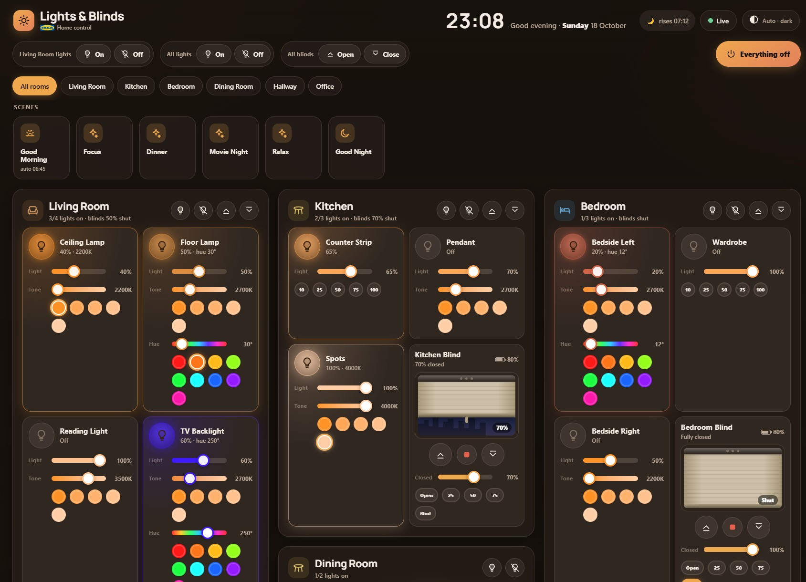

# Helios

Realtime web control for an IKEA DIRIGERA hub: lights, blinds, remotes and scenes.

A small Node.js server that has no dependencies. It keeps a live connection to the hub's WebSocket event stream and pushes every state change to all open browsers over Server-Sent Events. No polling.



## Features

- Lights: on/off, brightness, colour temperature and colour, picked to match what each bulb supports
- Blinds: open, close, stop, set position (drag the window)
- Room and whole-house group commands, scenes, remote battery levels
- All open screens update right away. Commands are coalesced per device so sliders don't flood the hub.
- Finds the hub automatically via mDNS, including after its IP changes
- JSON REST API and SSE event stream
- Uses about 45 MB of RAM, so it runs fine on a Raspberry Pi

## Requirements

- IKEA DIRIGERA hub on the same network
- Linux with systemd (Debian, Ubuntu, Raspberry Pi OS) for the install script
- Node.js 18 or newer (no npm packages needed)

## Install

```bash
git clone https://github.com/<you>/helios.git
cd helios
sudo ./install.sh
```

When the script asks, press the action button on the bottom of the hub to pair it.

Options:

| Option | Default | Description |
|---|---|---|
| `--dir` | `/opt/helios` | Install directory |
| `--user` | `helios` | System user the service runs as |
| `--port` | `3200` | HTTP port |
| `--hub-ip` | (mDNS) | Hub IP address, if discovery does not work on your network |

The script installs Node.js if it is missing and creates the service user. It copies the files, pairs with the hub (writing `token.txt`, mode 600), and installs and starts `helios.service`.

Open `http://<server-ip>:3200/`.

## Hub token

Helios uses an API token from the DIRIGERA hub. `install.sh` gets one for you. To get a new one later (for example after a hub reset), use either option below. Both ask you to press the action button on the bottom of the hub, which approves the pairing.

Option 1, the included script (no dependencies):

```bash
sudo TOKEN_FILE=/opt/helios/token.txt node /opt/helios/scripts/get-token.js [hub-ip]
```

Option 2, the [`dirigera`](https://www.npmjs.com/package/dirigera) npm package (same method as [denkigera](https://github.com/0xtosh/denkigera)):

```bash
npx dirigera authenticate
```

This prints the token. Then write it to the token file:

```bash
echo "PASTE_YOUR_TOKEN_HERE" | sudo tee /opt/helios/token.txt
```

With either option, fix the file's permissions and restart the service:

```bash
sudo chown helios:helios /opt/helios/token.txt
sudo chmod 600 /opt/helios/token.txt
sudo systemctl restart helios
```

## Manual setup

```bash
node scripts/get-token.js [hub-ip]   # pair with the hub, writes token.txt
HUB_IP=<hub-ip> node server.js       # HUB_IP is optional
```

## Demo mode

Run with a simulated hub that has fictional rooms, lights, blinds and scenes. You don't need a hub or a token:

```bash
npm run demo     # or: DEMO=1 node server.js
```

## Configuration

Set server options as environment variables (in `/etc/systemd/system/helios.service`):

| Variable | Default | Description |
|---|---|---|
| `PORT` | `3200` | HTTP port |
| `BIND` | `0.0.0.0` | Listen address |
| `HUB_IP` | (mDNS) | Hub IP address |
| `TOKEN_FILE` | `./token.txt` | Hub API token |
| `RESYNC_MS` | `60000` | Full resync interval |
| `RAW_WRITE` | `0` | `1` allows write requests through `/api/proxy/` |

UI options live in `public/config.js`: your location (for the sunrise/sunset light/dark theme) and the rooms to list first.

An example nginx config for serving Helios under `/helios/` is in `deploy/nginx.conf`.

## Operations

```bash
systemctl status helios
journalctl -u helios -f
curl -s localhost:3200/api/health
```

## API

All endpoints are under `/api` and use JSON. There is no authentication, so only run Helios on a trusted network.

| Method | Path | Description |
|---|---|---|
| GET | `/state` | Rooms, devices, scenes and hub status |
| GET | `/devices`, `/devices/:id`, `/rooms`, `/scenes` | Normalized views |
| GET | `/events` | SSE stream: `snapshot`, `patch`, `hub`, `log` |
| GET | `/log?limit=50` | Recent activity |
| GET | `/health`, `/stats` | Link state and counters |
| POST | `/devices/:id/command` | `{command, value?, hue?, saturation?}` |
| POST | `/batch` | Up to 40 device commands |
| POST | `/rooms/:id/command`, `/all/command` | `lights_on`, `lights_off`, `lights_set`, `everything_off`, `blinds_open`, `blinds_close`, `blinds_stop`, `blinds_set` |
| POST | `/scenes/:id/trigger` | Trigger a scene |
| PATCH | `/devices/:id` | `{attributes: {...}}`, limited to writable attributes |
| POST | `/resync` | Force a full resync |
| any | `/proxy/<hub path>` | Passthrough to the hub API (writes need `RAW_WRITE=1`) |

Device commands: lights `on`, `off`, `toggle`, `set` (0-100), `temp` (Kelvin), `color` (hue, saturation). Blinds `open`, `close`, `stop`, `toggle`, `set` (0-100, percent closed), `tilt`.

## Project layout

```
server.js            HTTP server, REST API, SSE, static files
lib/hub.js           Hub REST client and event stream
lib/ws.js            Minimal WebSocket client
lib/mdns.js          mDNS hub discovery
lib/store.js         Device state
lib/model.js         Device normalization and capability detection
lib/commands.js      Command planning and coalescing
public/              Web UI
scripts/get-token.js Hub pairing
deploy/              systemd unit and nginx example
install.sh           Installer
```

## Notes

- The hub token is a long-lived credential. Keep `token.txt` private (it is in `.gitignore`).
- The hub uses a self-signed certificate. Certificate checks for the hub connection are disabled.
- systemd `MemoryHigh`/`MemoryMax` need the memory cgroup enabled. On Raspberry Pi OS, add `cgroup_enable=memory` to `cmdline.txt`.
